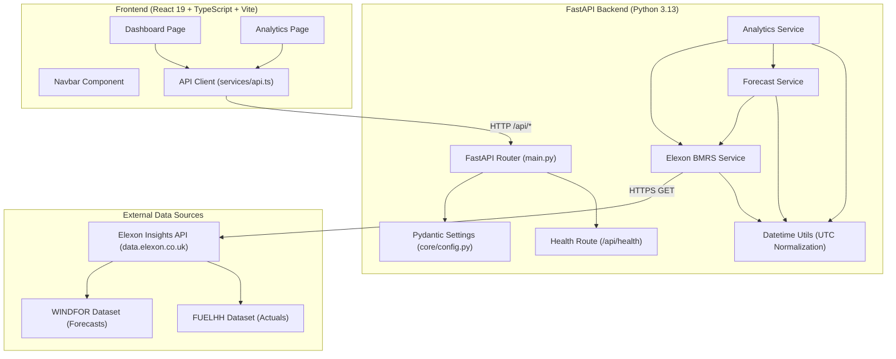

# Aerovolt — UK Wind Generation Forecasting & Analytics

[](https://www.python.org/)
[](https://fastapi.tiangolo.com/)
[](https://react.dev/)
[](https://www.typescriptlang.org/)
[](https://vitejs.dev/)
[](https://tailwindcss.com/)
[](https://pytest.org/)

Aerovolt is a specialized wind generation forecasting and procurement analytics dashboard tailored for participants in the Great Britain (GB) electricity market. It ingests national wind generation forecasts (`WINDFOR`) and half-hourly actual outturns (`FUELHH`) from the **Elexon Insights Solution (BMRS)** API, reconstructs procurement positions without lookahead bias, and evaluates forecast accuracy using industry-standard quantitative metrics (MAE, RMSE, Bias, and WAPE).

---

## Table of Contents

1. [Project Overview](#1-project-overview)
2. [Problem Statement & Market Relevance](#2-problem-statement--market-relevance)
3. [Features](#3-features)
4. [Screenshots](#4-screenshots)
5. [Technology Stack](#5-technology-stack)
6. [Architecture & Data Flow](#6-architecture--data-flow)
7. [Data Sources & Ingestion](#7-data-sources--ingestion)
8. [Forecast Selection & Temporal Semantics](#8-forecast-selection--temporal-semantics)
9. [Forecast Accuracy Evaluation](#9-forecast-accuracy-evaluation)
10. [Project Structure](#10-project-structure)
11. [Prerequisites](#11-prerequisites)
12. [Local Setup Guide](#12-local-setup-guide)
13. [Environment Configuration](#13-environment-configuration)
14. [API Reference & OpenAPI Docs](#14-api-reference--openapi-docs)
15. [Testing & Quality Verification](#15-testing--quality-verification)
16. [Docker & Containerization](#16-docker--containerization)
17. [Deployment Status](#17-deployment-status)
18. [Current Limitations & Roadmap](#18-current-limitations--roadmap)
19. [AI-Assisted Development Disclosure](#19-ai-assisted-development-disclosure)
20. [License](#20-license)

---

## 1. Project Overview

In the Great Britain electricity market, commercial offtakers and energy utilities contract electrical energy in day-ahead wholesale auctions (such as EPEX SPOT and Nord Pool) to balance anticipated consumer demand and generation assets. 

Because wind power is intermittent and weather-dependent, procurement teams rely heavily on short-term and day-ahead forecast models produced by the National Energy System Operator (NESO). Aerovolt delivers:
- **Decision-Time Replay:** The ability to inspect the exact forecast model published prior to procurement gate closures (e.g. Day-Ahead 17:00 UTC), strictly eliminating data leakage from subsequent intraday revisions.
- **Outturn Benchmarking:** Direct side-by-side comparison of forecasted generation against metered GB transmission outturn.
- **Financial Risk Mitigation:** Quantitative error tracking (MAE, RMSE, and Bias) to identify systematic over-forecasting or under-forecasting patterns that trigger cash-out imbalance penalties.

---

## 2. Problem Statement & Market Relevance

### The Commercial Impact of Forecast Errors
Under the GB Balancing and Settlement Code (BSC) administered by Elexon:
- **Settlement Periods:** Each 24-hour day is divided into 48 half-hour settlement periods (SP 1–48).
- **Gate Closure:** One hour before each settlement period delivery start time, trading ceases and market participants submit their Final Physical Notifications (FPNs).
- **Cash-Out Imbalances:** If a utility over-estimates wind generation and under-delivers, the shortfall is settled at the **System Buy Price (SBP)**, which spikes dramatically during high-demand or low-wind periods. If a utility under-estimates and generates surplus, the excess is cashed out at the **System Sell Price (SSP)**, frequently resulting in lost revenue.

### The Analytical Challenge
Upstream providers publish forecast revisions up to 8 times daily. Reconstructing historical procurement decisions requires isolating records where $\text{publishTime} \le \text{decisionTime}$. Traditional dashboards often fall victim to **lookahead bias** by visualizing post-closure revisions that were physically unavailable when purchasing decisions occurred. Aerovolt strictly enforces temporal boundaries across all services.

---

## 3. Features

- **Procurement Dashboard:**
  - Timeseries visualization (Recharts Area Profile) displaying projected generation across half-hourly settlement intervals.
  - KPI summary cards tracking **Peak Forecast (MW)**, **Average Forecast (MW)**, **Minimum Forecast (MW)**, and total interval counts.
  - Interactive settlement date and half-hour period (1–48) filters.
  - Delivery schedule table detailing `startTime`, `publishTime`, and forecasted MW output.
- **Accuracy & Performance Analytics:**
  - Statistical benchmark cards: **Mean Absolute Error (MAE)**, **Root Mean Squared Error (RMSE)**, **Mean Bias (ME)**, and **Weighted Absolute Percentage Error (WAPE)**.
  - Dual-line comparative timeseries chart overlaying selected forecasts against actual metered outturns.
  - Interval-by-interval settlement breakdown table highlighting signed error ($e_t$) and absolute error ($|e_t|$).
  - Clear visual indicators for missing actuals or missing forecast intervals.
- **Resilient UI Foundation:**
  - Accessible loading states (`LoadingState`) with ambient spinners and descriptive status messaging.
  - Structured error state panels (`ErrorState`) displaying diagnostic details and retry action callbacks.
  - Dark-mode optimized theme built with modern Tailwind CSS v4 and Lucide React icons.

---

## 4. Screenshots

> *Screenshots placeholder: Run the application locally via `npm run dev` to interact with the live UI.*

```text
+------------------------------------------------------------------------------------+
|  Aerovolt  [GB Grid]                                      [Dashboard] [Analytics]  |
|------------------------------------------------------------------------------------|
|  Settlement Date: [ 2026-01-01 ]   Period: [ All Periods (1-48) ]      [ Refresh ]  |
|                                                                                    |
|  [ Peak: 14,250 MW ]   [ Avg: 9,840 MW ]   [ Min: 4,120 MW ]   [ Points: 48 ]      |
|                                                                                    |
|  +------------------------------------------------------------------------------+  |
|  |  Recharts Generation Profile (MW over Settlement Periods 1 - 48)             |  |
|  +------------------------------------------------------------------------------+  |
+------------------------------------------------------------------------------------+
```

---

## 5. Technology Stack

### Frontend
| Component | Technology | Version | Purpose |
| :--- | :--- | :--- | :--- |
| **Framework** | React | `^19.3.1` | Component lifecycle and reactive UI |
| **Language** | TypeScript | `~6.0.3` | Strict type safety across contracts |
| **Build Tool** | Vite | `^8.3.4` | High-speed local dev and production bundling |
| **Styling** | Tailwind CSS | `^4.3.3` | Utility-first styling with `@tailwindcss/vite` |
| **Charts** | Recharts | `^3.10.1` | Timeseries area and dual-line charts |
| **Icons** | Lucide React | `^1.61.0` | Accessible SVG iconography |
| **Linter** | ESLint | `^10.13.0` | Code quality and React Hooks rules |

### Backend
| Component | Technology | Version | Purpose |
| :--- | :--- | :--- | :--- |
| **Runtime** | Python | `3.13.7` | High-performance asynchronous backend |
| **Framework** | FastAPI | `0.141.1` | OpenAPI documentation, ASGI routing, CORS |
| **Validation** | Pydantic v2 | `2.13.4` | Request/response parsing and schema validation |
| **Settings** | Pydantic Settings | `2.15.0` | Centralized environment variable loading |
| **Server** | Uvicorn | `0.52.1` | Production ASGI web server |
| **HTTP Client**| HTTPX | `0.28.1` | Asynchronous external Elexon BMRS integration |
| **Test Suite** | Pytest | `9.1.1` | Unit, integration, and mock transport testing |

---

## 6. Architecture & Data Flow

Aerovolt utilizes a decoupled client-server architecture:



---

## 7. Data Sources & Ingestion

Aerovolt integrates directly with the **Elexon Insights Solution (BMRS)** v1 API (`https://data.elexon.co.uk/bmrs/api/v1`):

### 1. `FUELHH` (Half-Hourly Generation by Fuel Type)
- **Endpoint:** `GET /datasets/FUELHH`
- **Description:** Metered transmission outturn aggregated by fuel category.
- **Filter Applied:** `fuelType == "WIND"`.
- **Key Fields Extracted:** `settlementDate`, `settlementPeriod`, `generation` (MW), `publishTime`.
- **Timestamp Logic:** When `startTime` is not explicitly provided in the payload, Aerovolt calculates the delivery start timestamp from `settlementDate` and `(settlementPeriod - 1) * 30 minutes` in UTC.

### 2. `WINDFOR` (Wind Generation Forecast)
- **Endpoint:** `GET /datasets/WINDFOR`
- **Description:** Aggregated wind power generation forecasts published by NESO models up to 8 times daily.
- **Key Fields Extracted:** `startTime` (delivery start in UTC), `publishTime` (model publication in UTC), `settlementDate`, `settlementPeriod`, `generation` (projected MW).
- **Sanitization:** Records with upstream formatting errors or lookahead violations ($\text{publishTime} > \text{startTime}$) are automatically rejected during ingestion.

---

## 8. Forecast Selection & Temporal Semantics

In electricity analytics, timestamps carry strict market semantics:
- **Delivery Start Time (`startTime`):** The half-hour window when electrical energy is generated and delivered onto the grid.
- **Publication Time (`publishTime`):** The exact moment the forecast model was generated and released by the system operator.
- **Decision Time ($T_{\text{decision}}$):** The cutoff timestamp representing when a market participant executed their procurement decision.

### Anti-Leakage Selection Algorithm
Implemented in [`backend/app/services/forecast_service.py`](file:///d:/Personal%20Project/Gridbricks/backend/app/services/forecast_service.py):
1. **Filter Candidates:** Exclude any forecast where $\text{publishTime} > T_{\text{decision}}$ or $\text{publishTime} > \text{startTime}$.
2. **Maximize Recency:** For each distinct `startTime`, select the record maximizing $\text{publishTime}$:
   $$\hat{y}(t) = \operatorname{argmax}_{\text{rec}} (\text{rec.publishTime}) \quad \text{s.t.} \quad \text{rec.publishTime} \le \min(T_{\text{decision}}, \text{rec.startTime})$$
3. **Day-Ahead View:** Automatically sets $T_{\text{decision}}$ to 17:00 UTC on $(D - 1)$ for settlement date $D$.
4. **Intraday Gate Closure:** Evaluates positions with an allowable lead time (e.g. 1 hour prior to `startTime`).

---

## 9. Forecast Accuracy Evaluation

Implemented in [`backend/app/services/analytics_service.py`](file:///d:/Personal%20Project/Gridbricks/backend/app/services/analytics_service.py):

Let $y_t$ represent metered actual generation (MW), $\hat{y}_t$ represent selected forecast generation (MW), and $N$ represent the count of complete evaluated intervals:

### 1. Mean Absolute Error (MAE)
$$\text{MAE} = \frac{1}{N} \sum_{t=1}^N |\hat{y}_t - y_t|$$
- **Interpretation:** The average absolute deviation in megawatts, representing expected volume exposure.

### 2. Root Mean Squared Error (RMSE)
$$\text{RMSE} = \sqrt{\frac{1}{N} \sum_{t=1}^N (\hat{y}_t - y_t)^2}$$
- **Interpretation:** Heavily penalizes large individual forecast misses, identifying periods of acute volatility.

### 3. Mean Bias / Mean Error (ME)
$$\text{Bias} = \frac{1}{N} \sum_{t=1}^N (\hat{y}_t - y_t)$$
- **Interpretation:** Identifies systematic over-forecasting ($\text{Bias} > 0$, causing utility shortfalls) or under-forecasting ($\text{Bias} < 0$, causing spillages).

### 4. Weighted Absolute Percentage Error (WAPE)
$$\text{WAPE} = \frac{\sum_{t=1}^N |\hat{y}_t - y_t|}{\sum_{t=1}^N y_t} \times 100\%$$
- **Zero-Generation Protection:** Percentage metrics become mathematically undefined or massively inflated when actual generation approaches zero. If total actual generation is below $1.0\text{ MW}$, Aerovolt suppresses WAPE and reports `null` to avoid misleading analytics.

---

## 10. Project Structure

```text
Aerovolt/
├── .agent/                      # Project-wide engineering rules & skills
│   ├── rules.md                 # Mandatory behavioral and coding rules
│   └── skills.md                # Energy domain guidelines & code patterns
├── .gitignore                   # Root ignore rules (Python, Node, OS, Agent)
├── README.md                    # Project documentation
├── backend/                     # FastAPI backend application
│   ├── .env.example             # Backend environment template
│   ├── .gitignore               # Python cache & env ignores
│   ├── myproject.toml           # Project metadata
│   ├── app/
│   │   ├── __init__.py
│   │   ├── main.py              # Application entry point, CORS, root route
│   │   ├── api/                 # API router organization
│   │   │   ├── __init__.py
│   │   │   └── routes/
│   │   │       ├── __init__.py
│   │   │       └── health.py    # Health-check endpoint (/api/health)
│   │   ├── core/                # Centralized settings & config
│   │   │   ├── __init__.py
│   │   │   └── config.py        # Pydantic Settings (env vars, CORS)
│   │   ├── schemas/             # Pydantic contracts & schemas
│   │   │   ├── __init__.py
│   │   │   ├── actual.py        # ActualGenerationRecord schemas
│   │   │   ├── analytics.py     # Comparison & AccuracyMetrics schemas
│   │   │   ├── common.py        # ErrorDetail, ErrorResponse schemas
│   │   │   └── forecast.py      # ForecastRecord schemas
│   │   ├── services/            # Business & integration services
│   │   │   ├── __init__.py
│   │   │   ├── analytics_service.py # Timeseries alignment & MAE/RMSE
│   │   │   ├── elexon_service.py    # FUELHH & WINDFOR API client
│   │   │   └── forecast_service.py  # Anti-leakage decision-time selection
│   │   └── utils/               # Datetime & UTC normalization helpers
│   │       ├── __init__.py
│   │       └── datetime_utils.py
│   └── tests/                   # Pytest test suite (49 automated tests)
│       ├── conftest.py
│       ├── test_analytics_service.py
│       ├── test_config.py
│       ├── test_datetime_utils.py
│       ├── test_elexon_service.py
│       ├── test_forecast_service.py
│       ├── test_health.py
│       └── test_schemas.py
└── frontend/                    # React 19 Vite application
    ├── .gitignore               # Frontend ignores (node_modules, dist)
    ├── package.json             # NPM dependencies & scripts
    ├── package-lock.json
    ├── vite.config.ts           # Vite config with @tailwindcss/vite
    ├── tsconfig.json            # TypeScript configuration
    ├── tsconfig.app.json
    ├── tsconfig.node.json
    ├── eslint.config.js         # ESLint 10 configuration
    ├── index.html               # Web entry HTML
    ├── public/                  # Static SVG assets
    └── src/
        ├── main.tsx             # React entry point
        ├── index.css            # Tailwind CSS v4 @import
        ├── App.tsx              # Page orchestration & layout
        ├── components/          # Reusable component library
        │   ├── index.ts
        │   ├── layout/
        │   │   ├── Navbar.tsx
        │   │   └── DashboardLayout.tsx
        │   └── common/
        │       ├── LoadingState.tsx
        │       └── ErrorState.tsx
        ├── pages/               # Application view pages
        │   ├── index.ts
        │   ├── Dashboard.tsx    # Forecast overview & chart
        │   └── Analytics.tsx    # MAE/RMSE benchmarks & table
        ├── services/            # Frontend API client
        │   └── api.ts           # Typed fetch wrapper
        └── types/               # TypeScript domain contracts
            ├── index.ts
            ├── actual.ts
            ├── analytics.ts
            ├── common.ts
            └── forecast.ts
```

---

## 11. Prerequisites

Before running Aerovolt locally, ensure the following software is installed on your system:

| Prerequisite | Minimum Version | Recommended Version | Verification Command |
| :--- | :--- | :--- | :--- |
| **Python** | `3.11+` | `3.13.7` | `python --version` |
| **Node.js** | `18+` | `20+` or `22+` | `node --version` |
| **npm** | `9+` | `10+` | `npm --version` |
| **Shell** | Windows PowerShell 5.1+ / PS Core 7+ | PowerShell 7+ | `$PSVersionTable.PSVersion` |

---

## 12. Local Setup Guide

Follow these step-by-step instructions in Windows PowerShell to launch both the backend and frontend locally:

### Step 1: Clone Repository
```powershell
git clone https://github.com/jayeshsutar92/Aerovolt.git
cd Aerovolt
```

### Step 2: Configure & Start Backend
Open a PowerShell terminal:

```powershell
# Navigate into backend directory
cd backend

# Create your local environment file from template
Copy-Item .env.example .env

# (Optional) Create and activate a Python virtual environment
python -m venv .venv
.\.venv\Scripts\Activate.ps1

# Install required Python dependencies
pip install fastapi uvicorn pydantic pydantic-settings httpx pytest python-dotenv

# Run the FastAPI development server
python -m uvicorn app.main:app --reload --host 127.0.0.1 --port 8000
```
*The backend API will start at `http://127.0.0.1:8000` with interactive Swagger docs at `http://127.0.0.1:8000/docs`.*

### Step 3: Configure & Start Frontend
Open a **second** PowerShell terminal:

```powershell
# Navigate into frontend directory
cd frontend

# Install npm dependencies
npm install

# Start the Vite development server
npm run dev
```
*The React application will launch at `http://localhost:5173`.*

---

## 13. Environment Configuration

All backend environment settings are loaded through [`backend/app/core/config.py`](file:///d:/Personal%20Project/Gridbricks/backend/app/core/config.py). A template is provided in [`backend/.env.example`](file:///d:/Personal%20Project/Gridbricks/backend/.env.example).

### Configuration Variables

| Variable | Type | Default | Description |
| :--- | :---: | :--- | :--- |
| `APP_NAME` | string | `Aerovolt` | Application display name |
| `ENVIRONMENT` | string | `development` | Runtime environment (`development`, `test`, `production`) |
| `VERSION` | string | `0.1.0` | API semver version |
| `DEBUG` | boolean | `false` | Enables verbose debug logs |
| `API_PREFIX` | string | `/api` | Base prefix for all registered API endpoints |
| `CORS_ORIGINS` | string / list | `http://localhost:5173,http://127.0.0.1:5173` | Allowed frontend origins (wildcard `*` prohibited in production) |
| `ELEXON_BASE_URL` | string | `https://data.elexon.co.uk/bmrs/api/v1` | Upstream Elexon Insights Solution REST base URL |
| `ELEXON_TIMEOUT_SECONDS` | float | `15.0` | Request timeout for Elexon BMRS network calls |
| `VITE_API_BASE_URL` *(frontend)* | string | `http://localhost:8000` | Target URL for frontend API client |

> [!IMPORTANT]
> Never commit `.env` files or secret keys to source control. `.env` is ignored in `.gitignore`.

---

## 14. API Reference & OpenAPI Docs

The backend automatically serves interactive API documentation:
- **Swagger UI:** `http://127.0.0.1:8000/docs`
- **ReDoc:** `http://127.0.0.1:8000/redoc`
- **OpenAPI JSON:** `http://127.0.0.1:8000/openapi.json`

### Implemented & Registered Endpoints

#### `GET /api/health`
Performs operational health check.
- **Response `200 OK`:**
  ```json
  {
    "status": "healthy",
    "app": "Aerovolt",
    "environment": "development",
    "version": "0.1.0"
  }
  ```

#### `GET /`
Root index route providing service status and quick links.
- **Response `200 OK`:**
  ```json
  {
    "message": "Aerovolt backend is running",
    "docs_url": "/docs",
    "health_check": "/api/health"
  }
  ```

### Service Contracts & Planned Endpoints
The frontend client ([`frontend/src/services/api.ts`](file:///d:/Personal%20Project/Gridbricks/frontend/src/services/api.ts)) is built against the following domain contracts serviced by [`ForecastService`](file:///d:/Personal%20Project/Gridbricks/backend/app/services/forecast_service.py) and [`AnalyticsService`](file:///d:/Personal%20Project/Gridbricks/backend/app/services/analytics_service.py):
- **`GET /api/forecasts`:** Queries wind generation forecasts with optional `settlement_date`, `settlement_period`, and `decision_time` filters. Returns `ForecastListResponse`.
- **`GET /api/analytics`:** Queries aligned forecast-versus-actual points and quantitative accuracy metrics (`mae`, `rmse`, `bias`, `wape_percent`). Returns `ComparisonResponse`.

---

## 15. Testing & Quality Verification

Aerovolt maintains rigorous automated testing and static analysis standards:

### 1. Backend Pytest Suite
Run the full test suite in `backend/`:
```powershell
cd backend
python -m pytest tests -v
```
**Verified Results:**
- `49 passed in 0.35s`
- Includes tests for:
  - `FUELHH` and `WINDFOR` Elexon parsing, filtering, and error handling with mock transport.
  - Decision-time forecast selection (strictly rejecting forecasts published after decision time).
  - Day-Ahead (D-1 17:00 UTC) and Gate Closure selection logic.
  - Timeseries alignment and MAE/RMSE/Bias/WAPE mathematical accuracy.
  - Zero-generation WAPE suppression.
  - Pydantic schema validation and UTC timestamp normalization.
  - CORS header handling and production wildcard rejection.

### 2. Frontend ESLint Checks
Run linting in `frontend/`:
```powershell
cd frontend
npm run lint
```
**Verified Results:** `0 errors, 0 warnings`.

### 3. Frontend Production Build & Typecheck
Run type-checking and bundling in `frontend/`:
```powershell
cd frontend
npm run build
```
**Verified Results:** `tsc -b && vite build` compiled 2,517 modules cleanly in `466ms`.

---

## 16. Docker & Containerization

> [!NOTE]
> Docker containerization is currently **in planning**. No `Dockerfile` or `docker-compose.yml` has been committed to the repository yet.

### Planned Containerization Architecture
When containerized:
- **Backend Service:** Base image `python:3.13-slim`, running `uvicorn app.main:app` on port `8000`.
- **Frontend Service:** Multi-stage build (`node:22-alpine` builder outputting to `nginx:alpine`), reverse proxying `/api` requests to the backend container.
- **Orchestration:** `docker-compose.yml` defining unified networking, health checks, and environment injection.

---

## 17. Deployment Status

- **Cloud Deployment:** Incomplete / Pending.
- **Live Deployment URL:** Currently, no public cloud instance (e.g. AWS, Render, or Vercel) is provisioned.
- **Operational Status:** The project is fully functional in a local development environment. Production deployment requires establishing container infrastructure and continuous deployment pipelines.

---

## 18. Current Limitations & Roadmap

1. **API Route Exposure:** `ForecastService` and `AnalyticsService` are fully implemented and unit-tested in Python, but dedicated FastAPI HTTP routes (`/api/forecasts` and `/api/analytics`) have not yet been mounted in `backend/app/api/routes/`. The frontend handles this gracefully via its `ErrorState` retry mechanism.
2. **Local Caching Layer:** Upstream Elexon BMRS API calls currently query directly. Adding a database (PostgreSQL/SQLite) or Redis cache will significantly reduce external API latency.
3. **Solar & BESS Expansion:** Expand beyond wind power into solar PV generation outturns and Battery Energy Storage System (BESS) arbitrage analytics.
4. **Intraday Horizon Sliders:** Add an interactive timeline slider to the UI to visualize how forecast accuracy evolves as the lead time shrinks from 24 hours to 1 hour ahead of gate closure.

---

## 19. AI-Assisted Development Disclosure

In accordance with transparent software development practices:
- This project was developed with assistance from **Antigravity**, an agentic AI coding assistant developed by the Google DeepMind team.
- **Gemini 3.8 Flash** was utilized as the underlying foundation model during the development workflow.
- **Scope of AI Assistance:** AI assistance was employed for architectural scaffolding, implementing FastAPI backend services and Pydantic schemas, authoring React 19 / TypeScript components and Recharts visualizations, creating automated pytest suites with mock transports, and performing repository hygiene.
- **Human Verification:** All generated code, linting suites, and test cases were verified and executed in the local terminal environment.

---

## 20. License

This repository does not currently include an open-source license. All rights are reserved by the project author. For inquiries regarding licensing or commercial evaluation, contact the repository maintainers.
